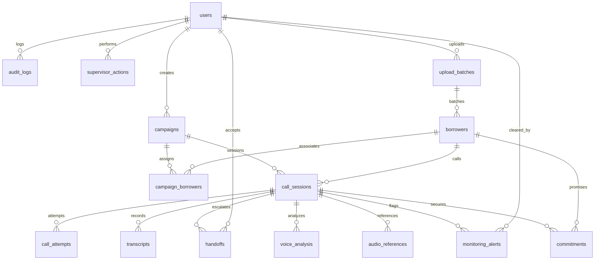

# VOXGUARD — Database Schema

PostgreSQL 17 Relational Schema Specification.

## Tables

### 1. `users`
- `id` (PK, Integer)
- `email` (VARCHAR(255), UNIQUE, INDEX)
- `full_name` (VARCHAR(255))
- `hashed_password` (VARCHAR(255))
- `role` (ENUM: ADMIN, CAMPAIGN_MANAGER, HUMAN_COLLECTOR, SUPERVISOR)
- `is_active` (BOOLEAN)
- `created_at`, `updated_at` (TIMESTAMPTZ)

### 2. `upload_batches`
- `id` (PK, Integer)
- `batch_id` (VARCHAR(50), UNIQUE, INDEX)
- `filename` (VARCHAR(255))
- `file_path` (VARCHAR(500))
- `file_size_bytes` (INTEGER)
- `uploaded_by_id` (FK -> users.id, nullable)
- `total_rows` (INTEGER)
- `valid_rows` (INTEGER)
- `imported_rows` (INTEGER)
- `rejected_rows` (INTEGER)
- `duplicate_rows` (INTEGER)
- `status` (VARCHAR(50)) -- PENDING, COMPLETED, FAILED, PARTIAL
- `summary` (JSON)
- `created_at`, `updated_at` (TIMESTAMPTZ)

### 3. `borrowers`
- `id` (PK, Integer)
- `borrower_id` (VARCHAR(50), UNIQUE, INDEX) -- Master external ID
- `upload_batch_id` (FK -> upload_batches.id, nullable, INDEX)
- `account_number` (VARCHAR(50), nullable, INDEX)
- `name` (VARCHAR(255), INDEX)
- `phone` (VARCHAR(30), INDEX)
- `preferred_language` (VARCHAR(30))
- `emi_amount` (NUMERIC(12,2))
- `outstanding_amount` (NUMERIC(12,2), INDEX)
- `due_date` (DATE, INDEX)
- `eligibility_status` (ENUM: ELIGIBLE, INELIGIBLE, DO_NOT_CALL, REQUIRES_REVIEW)
- `risk_score` (NUMERIC(4,2))
- `stop_contact` (BOOLEAN, default False)
- `dispute_status` (VARCHAR(50), default 'NONE')
- `created_at`, `updated_at` (TIMESTAMPTZ)

### 4. `campaigns`
- `id` (PK, Integer)
- `name` (VARCHAR(255), UNIQUE, INDEX)
- `description` (TEXT, nullable)
- `status` (VARCHAR(50)) -- DRAFT, SCHEDULED, ACTIVE, PAUSED, COMPLETED, CANCELLED
- `target_language` (VARCHAR(50))
- `start_date` (TIMESTAMPTZ, nullable)
- `end_date` (TIMESTAMPTZ, nullable)
- `retry_limit` (INTEGER, default 3)
- `cooling_off_hours` (INTEGER, default 24)
- `created_by_id` (FK -> users.id, nullable)
- `created_at`, `updated_at` (TIMESTAMPTZ)

### 5. `campaign_borrowers`
- `id` (PK, Integer)
- `campaign_id` (FK -> campaigns.id, INDEX)
- `borrower_id` (FK -> borrowers.id, INDEX)
- `priority` (INTEGER, default 1)
- `calling_status` (VARCHAR(50)) -- QUEUED, IN_PROGRESS, COMPLETED, FAILED, ESCALATED, SAFE_TERMINATED
- `retry_count` (INTEGER, default 0)
- `is_active_call` (BOOLEAN, default False) -- Duplicate simultaneous call protection
- `last_attempt_at` (TIMESTAMPTZ, nullable)
- `notes` (TEXT, nullable)
- `created_at`, `updated_at` (TIMESTAMPTZ)
- *Constraint*: `UNIQUE(campaign_id, borrower_id)`

### 6. `call_sessions`
- `id` (PK, Integer)
- `session_uuid` (VARCHAR(36), UNIQUE, INDEX)
- `campaign_id` (FK -> campaigns.id, nullable, INDEX)
- `borrower_id` (FK -> borrowers.id, INDEX)
- `status` (VARCHAR(50))
- `language` (VARCHAR(30))
- `start_time`, `end_time` (TIMESTAMPTZ, nullable)
- `duration_seconds` (FLOAT)
- `final_outcome` (VARCHAR(100), nullable)
- `is_escalated` (BOOLEAN)
- `escalation_reason` (TEXT, nullable)
- `created_at`, `updated_at` (TIMESTAMPTZ)

### 7. `call_attempts`, `transcripts`, `voice_analysis`, `audio_references`, `handoffs`, `monitoring_alerts`, `commitments`, `supervisor_actions`, `audit_logs`
- Maintained as specified in Phase 1 models.
